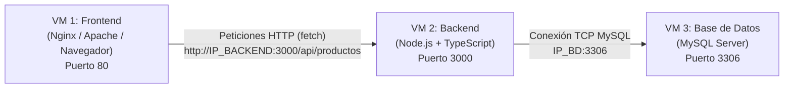

# Proyecto CRUD (Front, Back y BD en Máquinas Virtuales)

Este proyecto está preparado para desplegarse tanto en local como en **3 máquinas virtuales independientes**:



---

## 🛠️ Configuración para 3 Máquinas Virtuales (VMs)

### 1. VM de Base de Datos (MySQL)
1. Ejecuta el script [`BD/schema.sql`](file:///c:/Users/ASUS/Documents/Javier/Despliegue/BD/schema.sql).
2. Permite conexiones remotas en MySQL:
   * En `/etc/mysql/mysql.conf.d/mysqld.cnf` (o `my.cnf`), cambia `bind-address = 127.0.0.1` a:
     ```ini
     bind-address = 0.0.0.0
     ```
   * Crea un usuario que acepte conexiones desde cualquier IP o desde la IP del Backend:
     ```sql
     CREATE USER 'crud_user'@'%' IDENTIFIED BY 'tu_contraseña';
     GRANT ALL PRIVILEGES ON crud_db.* TO 'crud_user'@'%';
     FLUSH PRIVILEGES;
     ```
   * Reinicia MySQL: `sudo systemctl restart mysql`
   * Abre el puerto **3306** en el firewall (ej. `sudo ufw allow 3306`).

---

### 2. VM de Backend (Node.js + TypeScript)
1. Copia la carpeta `Back/` a la máquina virtual.
2. Edita el archivo [`.env`](file:///c:/Users/ASUS/Documents/Javier/Despliegue/Back/.env):
   ```ini
   PORT=3000
   HOST=0.0.0.0
   DB_HOST=<IP_DE_LA_MAQUINA_BD>    # Ej. 192.168.1.50
   DB_USER=crud_user
   DB_PASSWORD=tu_contraseña
   DB_NAME=crud_db
   DB_PORT=3306
   ```
3. Instala dependencias y corre el servidor:
   ```bash
   npm install
   npm run build
   npm start
   # O en desarrollo: npm run dev
   ```
4. Abre el puerto **3000** en el firewall de esta máquina (ej. `sudo ufw allow 3000`).

---

### 3. VM de Frontend (HTML, CSS y JS)
1. Copia la carpeta `Front/` a la máquina virtual (puedes servirla con Nginx, Apache o simplemente abrir el archivo).
2. Edita el archivo [`Front/config.js`](file:///c:/Users/ASUS/Documents/Javier/Despliegue/Front/config.js):
   ```javascript
   const CONFIG = {
       API_URL: 'http://<IP_DE_LA_MAQUINA_BACKEND>:3000/api/productos'
   };
   ```
3. ¡Listo! Al abrir `index.html`, el navegador se conectará directamente a la IP del Backend, y este consultará a la IP de la Base de Datos.
